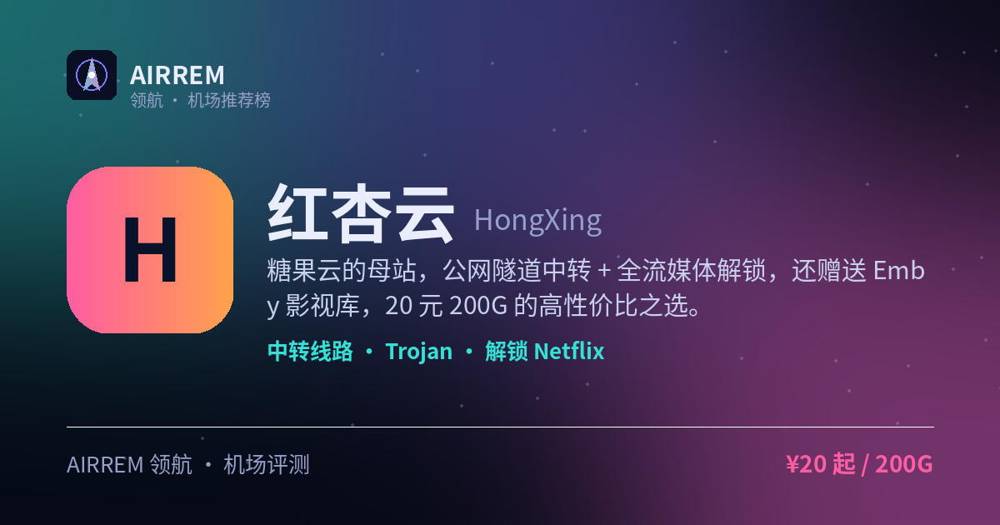

# 红杏云机场评测 2026：流媒体 / 大流量性价比，官网注册入口与套餐价格

> **红杏云** 适合谁？既要追剧又要囤大流量的性价比党。IEPL 专线 + 赠 EMBY 影视库，大流量还便宜：月付 ¥80 就有 1200G，独有不限时大流量买断（3000G ¥388 / 6000G ¥688），追剧囤量两不误

👉 **[红杏云 官网注册入口](https://i.rtxk.us/i/mycugbg)** ｜ 优惠码：`lu88` ｜ [完整评测与横向对比](https://555736.xyz/hongxing/)

---

## 我们的结论

升级为全线 IEPL 专线后更能打：月付四档都赠送 EMBY 私人影视库、设备不限支持家庭共享，且大流量档很便宜（¥80/1200G）；最独特的是还有别家少见的不限时大流量买断（3000G ¥388、6000G ¥688、用完为止），既想追剧又想囤大流量的性价比党最合适。备用域名较多，认准官方地址；新站建议先月付验证晚高峰。

## 基本信息

| 项目 | 内容 |
| --- | --- |
| 机场名称 | 红杏云（红杏 · HXY） |
| 成立时间 | 2024 |
| 线路类型 | IEPL 专线 |
| 支持协议 | Trojan / Hysteria2 |
| 流媒体解锁 | Netflix / Disney+ / ChatGPT / Emby 影视库 |
| 节点地区 | 香港 · 日本 · 台湾 · 新加坡 · 美国 等 |
| 计费方式 | 月付（至 3 年付）/ 不限时买断 |
| 起步价格 | ¥20 / 月 200G |
| 推荐场景 | 既要追剧又要囤大流量的性价比党 |
| Emby 影音 | 支持 |

## 红杏云 套餐价格

| 套餐 | 价格 | 说明 |
| --- | --- | --- |
| 轻量-包月200G | ¥20 | 月付 · 200G · 300Mbps · 不限设备 · 赠 EMBY · IEPL 专线 |
| 冲浪-包月500G | ¥40 | 月付 · 500G · 500Mbps · 不限设备 · 赠 EMBY · IEPL |
| 豪华-包月800G | ¥60 | 月付 · 800G · 800Mbps · 不限设备 · 赠 EMBY · IEPL |
| 大师-包月1200G | ¥80 | 月付 · 1200G · 1000Mbps · 不限设备 · 赠 EMBY · IEPL |
| 高级-不限时3000G | ¥388 | 一次性买断 · 3000G 用完为止 · 1000Mbps · 不限设备 |
| 豪华-不限时6000G | ¥688 | 一次性买断 · 6000G 用完为止 · 1000Mbps · 最多 20 设备 |

> 月付套餐每月按订单日重置流量并赠送 EMBY 影视库、设备不限；不限时套餐为一次性买断、用完为止；全线 IEPL 专线，多周期可选（月付到 3 年付），可购买重置包，价格以官网实时为准。

## 红杏云是什么

红杏云（HongXing）是 2024 年中上线的机场，与专线站「糖果云」同源。经过升级，红杏云现已全线采用 IEPL 专线传输，把资源砸在流媒体解锁与大流量性价比上，并赠送 EMBY 私人影视库。

注意：市面上有同名旧站与「一枝红杏」等，均非同一运营实体；红杏云备用域名较多，购买前请认准官方永久地址，避免钓鱼假站。

## 线路与节点

红杏云现全线走 IEPL 专线传输，晚高峰更抗拥堵、延迟更低；国际节点覆盖香港、日本、台湾、新加坡、美国等常用地区，原生 IP 较多、解锁友好。

- 全线 IEPL 专线传输，晚高峰稳、延迟低
- 热门节点：香港 / 日本 / 台湾 / 新加坡 / 美国
- 设备不限制，支持家庭成员共享
- 带宽随档位递增（300 → 1000Mbps）

> 💡 周期套餐赠送 EMBY 影视库；不限时买断套餐主打大流量、用完为止（不含 EMBY 赠送）。

## 协议与客户端

采用 Trojan 与 Hysteria2 协议，兼容主流客户端，导入订阅即可用。

- 支持 Clash、Shadowrocket、Quantumult X、Stash、sing-box、Hiddify 等
- Hysteria2 节点需用支持该协议的客户端
- 支付方式：支付宝 / 微信 / USDT

## 解锁与影视库

核心卖点是全流媒体解锁 + 影视库：稳定解锁 Netflix、Disney+、YouTube Premium 与 ChatGPT / OpenAI，4K 秒播；周期套餐赠送 EMBY 私人影视库，装上 EMBY 客户端登录即可直接看片。

## 优点与缺点

**✅ 优点**

- 全线 IEPL 专线传输，晚高峰稳、延迟低
- 月付四档赠送 EMBY 影视库，追剧免找资源
- 大流量还便宜：¥80/1200G，性价比高
- 独有不限时大流量买断（3000G ¥388 / 6000G ¥688）
- 设备不限、支持家庭共享，全流媒体解锁
- 支付方式多（支付宝 / 微信 / USDT）

**⚠️ 缺点**

- 2024 年新站，建议先月付验证晚高峰
- 不限时套餐不含 EMBY 赠送
- 备用域名多，注意认准官方地址防钓鱼
- 6000G 不限时档限 20 台设备

## 适合谁 / 不适合谁

| 👍 适合 | 👎 不适合 |
| --- | --- |
| 既要追剧、又要囤大流量的性价比党 | 只信老牌、追求长期稳定的用户 |
| 重流媒体解锁、想要 EMBY 影视库、多设备家庭共享 | 偏好一次性大额年付求稳的用户 |
| 想一次性买断大流量长期备用的用户 |  |

## 常见问题

**Q：红杏云和糖果云是什么关系？**

A：两者同源。现在红杏云本站也已全线升级 IEPL 专线；区别在定位：红杏云更主打「性价比 + 大流量」，月付大流量档更便宜，还独有不限时大流量买断套餐；糖果云则更聚焦纯月付的追剧影视体验。按需求二选一即可。

**Q：不限时套餐和月付套餐有什么区别？**

A：月付套餐每月按订单日重置流量、并赠送 EMBY 影视库；不限时套餐（3000G / 6000G）是一次性买断、用完为止，主打大流量长期备用（不含 EMBY 赠送）。

**Q：新站会不会跑路？**

A：红杏云 2024 年中上线，属于新站。稳妥做法是先买月付（约 ¥20/200G）验证晚高峰稳定性，别一上来大额年付，并认准官方永久域名，避免钓鱼假站。

## 同类机场推荐

拿不定主意？可以再看看这几家同类型的：

- **[西部数据](https://555736.xyz/westdata/)** — 稳定专线党，¥17 起
- **[糖果云](https://555736.xyz/candycloud/)** — 影视追剧旗舰，¥18 起
- **[渔云](https://555736.xyz/yuyun/)** — 长期稳定 / Emby 影音，¥9 起

全部 38 家机场的横向对比与选购方法论：**[信号塔 SignalTower · 机场大全](https://555736.xyz/airports/)**

---

数据更新：2026-07 ｜ 价格、套餐与优惠码以官网实时为准 ｜ 本仓库为第三方评测整理，与 红杏云 官方无隶属关系 ｜ 请遵守当地法律法规使用网络服务。

关键词：红杏云、HongXing、红杏云机场、IEPL专线、Emby机场、Emby影视库、不限时买断、大流量机场、流媒体解锁、机场推荐、机场评测
